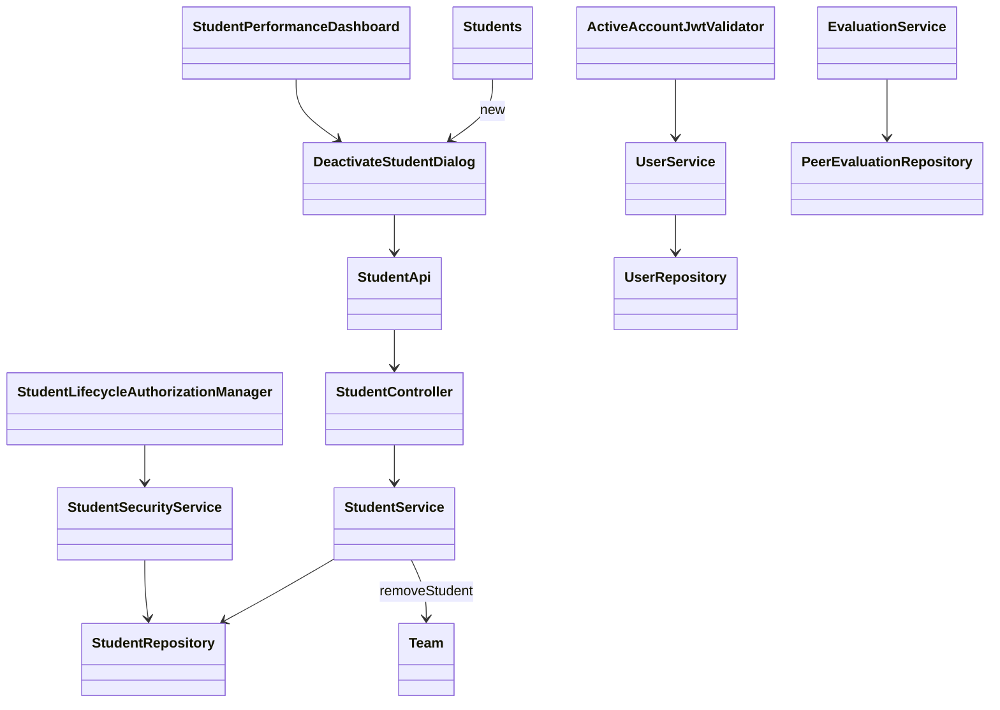
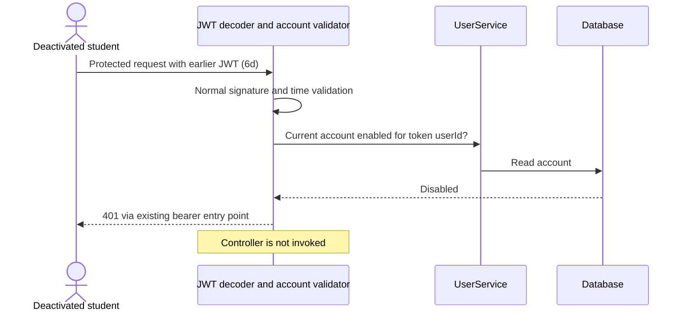

# Student Design

> Realizes: [UC-STU-deactivate-student](../requirements/use-cases.md#uc-stu-deactivate-student-the-course-admininstructor-deactivates-a-student)
> Depends on: FR-SEC-authentication, FR-SEC-authorization, FR-SEC-active-account ([SRS](../requirements/software-requirements-specification.md#security-and-authorization-requirements)).
> State: approved shape; implementation pending the design PR merge. Reactivation is not implemented by this design.

## Overview

Extend the existing student vertical slice and reuse the [platform containers](architectural-design.md#containers), [architectural conventions](architectural-design.md#architectural-conventions), and [Business Domain Model](../requirements/software-requirements-specification.md#business-domain-model). The existing implementation changes `enabled` through profile editing; the dedicated transition replaces that deactivation path. Policy is owned by the use case and BR-student-lifecycle, BR-student-deactivation-team, BR-deactivated-student-evaluations, BR-team-admin-only, and BR-submission-owed in [business rules](../requirements/business-rules.md).

## Components and classes



- Reused/extended: [Students.vue](../../frontend/src/pages/students/Students.vue), [StudentPerformanceDashboard.vue](../../frontend/src/pages/students/StudentPerformanceDashboard.vue), [student API](../../frontend/src/apis/student/index.ts), [EditStudentForm.vue](../../frontend/src/pages/students/EditStudentForm.vue). Add one shared `DeactivateStudentDialog.vue` in the student pages directory; display status beside the name in the list and selected details.
- Reused/extended: [StudentController](../../backend/src/main/java/team/projectpulse/student/StudentController.java), [StudentService](../../backend/src/main/java/team/projectpulse/student/StudentService.java), [StudentRepository](../../backend/src/main/java/team/projectpulse/student/StudentRepository.java), [StudentSecurityService](../../backend/src/main/java/team/projectpulse/student/StudentSecurityService.java), and [Team.removeStudent](../../backend/src/main/java/team/projectpulse/team/Team.java).
- New: `security/authorizationmanagers/StudentLifecycleAuthorizationManager` delegates the course-owner/assigned-instructor predicate to `StudentSecurityService`. Do not reuse self-access from `UserOwnershipAuthorizationManager` for deactivation.
- New: `security/ActiveAccountJwtValidator`; extend [UserService](../../backend/src/main/java/team/projectpulse/user/UserService.java) with a read-only current-status lookup by stable user ID. Wire the validator in [SecurityConfiguration](../../backend/src/main/java/team/projectpulse/security/SecurityConfiguration.java).
- Reused/extended: [EvaluationService](../../backend/src/main/java/team/projectpulse/evaluation/EvaluationService.java) and [PeerEvaluationRepository](../../backend/src/main/java/team/projectpulse/evaluation/PeerEvaluationRepository.java). Reuse [SubmissionStatusService](../../backend/src/main/java/team/projectpulse/notification/SubmissionStatusService.java) unchanged unless a test reveals divergence.

## Sequence

```mermaid
sequenceDiagram
    actor I as Course admin or assigned instructor
    participant UI as Student screen and dialog
    participant SEC as Authentication and route security
    participant C as StudentController
    participant S as StudentService
    participant DB as Database
    I->>UI: Select student and Deactivate (1–3)
    UI-->>I: Consequences and confirmation (4)
    alt Cancel or dismiss (4a)
        UI-->>I: Close; no POST
    else Confirm (5)
        UI->>SEC: POST /students/{studentId}/deactivate
        SEC->>SEC: Validate caller account and course permission (2a)
        SEC->>C: Authorized request
        C->>S: deactivateStudent(studentId)
        S->>DB: Load caller-scoped student with write lock
        alt Already inactive (3a)
            S-->>C: Unchanged student; already-deactivated outcome
        else Active (6)
            S->>S: Team.removeStudent if assigned (6a/6b)
            S->>DB: Set enabled=false; commit both changes
            DB-->>S: Committed; historical records untouched (6c)
            S-->>C: Updated student
        end
        C-->>UI: Result with student DTO and outcome message
        UI-->>I: Refresh status and team; show outcome (6–7)
    end
```



## API contract

Paths are relative to `${api.endpoint.base-url}` (normally `/api/v1`). Responses use the existing `Result` envelope and `StudentDto` converter.

| Endpoint | Caller | Request | Success | Extensions and errors |
|---|---|---|---|---|
| **New** `POST /students/{studentId}/deactivate` | Owning course admin or assigned course-section instructor; explicit instructor/admin role plus relationship | Path ID, no body | HTTP 200, `flag=true`, updated `StudentDto`, message `Student deactivated successfully` | 3a: HTTP 200, `flag=true`, unchanged DTO, exact message `Student is already deactivated`. 2a: HTTP 403, including unknown IDs to fail closed without revealing account existence. Missing/invalid authentication or inactive caller: 401. Malformed path ID: deny at the route guard. |
| **Changed** `PUT /students/{studentId}` | Existing authorized callers | Existing profile DTO | Existing profile-update result if enabled status is unchanged | Reject any attempted enabled-status transition with HTTP 400 and no profile writes, instructing the caller to use the dedicated lifecycle action. Remove the status switch. No reactivation endpoint is added. |
| **Adjusted access only** `GET /students/{studentId}` and `GET /evaluations/students/{studentId}/week/{week}/details` | Preserve existing callers; additionally admit the owning course admin via the lifecycle relationship predicate | Existing path fields | Existing DTO/report | Preserve scope/privacy restrictions. No broad role-only admin bypass. This lets an owning admin who is not assigned as instructor reach the selected student's details and retained records. |
| **Changed selection** `GET /evaluations/sections/{sectionId}/week/{week}` | Assigned instructor or owning course admin (`anyOf` existing course-section managers) | Existing path fields | Existing report shape, including historical evaluatees without a current team | 6c: include students with evaluations for the requested week even if inactive/unassigned; current active team members retain existing empty-row behavior. Inactive students with no evaluations for that week have no empty row. |
| **Additional validation** `POST /evaluations` | Existing authenticated author, with normal team/window checks | Existing body | Existing result for permitted submissions | BR-deactivated-student-evaluations: HTTP 400 for inactive evaluatee, including a direct request naming her ID. Stored evaluations remain readable; this rule does not redefine the existing edit window for earlier evaluations. |

Cancellation sends no POST. Disable confirmation during the request; after success or 3a update the selected student and reload the list. On a timeout/network error do not claim success: show that the outcome is unknown and reload status before offering another action. Repeating the POST is safe under 3a. Never offer a reactivation control in this build.

## Key decisions

- **Caller scope at both enforcement points.** The new route manager checks role plus course ownership or course-section assignment, using the student's course section rather than team (which is removed). The service uses a caller-scoped repository query for the selected student and repeats the same predicate. Rejected reusing self-access or checking `ROLE_admin` alone: neither proves this caller may manage this student. Null/missing relationships deny access.
- **Atomic transition and repeat handling.** Lock the caller-scoped student row using JPA pessimistic write locking, then test `enabled`, remove the team association through the existing helper, and set the flag in one transaction. Do not delete submitted records or invoke the ordinary team-removal workflow and its email side effects. Rejected independent updates: they could leave a disabled student assigned or an active student unexpectedly unassigned after failure. Concurrent deactivation requests serialize and return 3a after the first commit. General team reassignment concurrency is outside this change.
- **Live account lookup.** Add the account validator alongside `JwtValidators.createDefault()` in the decoder; retain signature/expiry checks and existing entry-point formatting. Query `UserService` by `userId` without a status cache; missing/malformed ID or missing/disabled account fails closed. Rejected trusting the token's login-time state or waiting two hours. Basic authentication already uses the live principal's enabled flag. No token format change, refresh mechanism, or individual-token blocklist. The check applies to student and instructor accounts under FR-SEC-active-account. A database failure cannot grant access.
- **Historical selection from records.** Build the course-section report from current active team members plus distinct evaluatees with records for the selected week, restricted to the requested course section. Use a bulk repository query, not a query per student, to discover those evaluatees. Rejected filtering solely by current team/account status: it hides retained history. Team names for former members can be absent; no historical team-name snapshot is invented. Weekly activities already retain their own team relationship; verify rather than rewrite their query.
- **One lifecycle path.** Validate an attempted status change before any ordinary profile fields are mutated. Rejected keeping the old editable status switch: it bypasses confirmation and the dedicated transition. Reactivation remains a future use case; its Associated Information records the separate course-admin team assignment.
- **Visible status and warning.** Reuse Element Plus tags/dialogs and the existing Axios authentication-failure handling. Text labels accompany green/red badges. Rejected color-only name styling, which does not convey status to everyone. The warning names the selected student and states the consequences cited in the use case, including no reminders or new evaluations and preserved historical work.

## Data model and architecture delta

No tables, columns, or migrations. Reuse `PeerEvaluationUser.enabled`, nullable `Student.team`, and existing evaluation/student and activity/team references from the SRS model. Preserve the student's course-section enrollment. Deactivation commits before a later authentication check must observe disabled status; requests already executing are not retroactively canceled. Reactivation does not restore team membership; historical team membership intervals are not introduced.

The user approved a narrow Level-1 update to [Authentication](architectural-design.md#authentication), its foundation security/user relationship, and TD-jwt-revocation wording: distinguish designed account-status enforcement from individual-token revocation. Mark the new behavior as designed, not already implemented. No container, deployment, platform stack, or RAM component-boundary change.

## Tests

Names below are planned tests, not claims of existing coverage. Backend service/unit tests cover decisions; integration tests must exercise real security and persistence. The existing `jwt()` test helper bypasses token decoding, so T08 must obtain a real signed token through login. Cypress tests may stub API responses for UI assertions and must be described as such in traceability.

| ID | Use-case flow or oracle | Level | Assertions |
|---|---|---|---|
| T01 | Steps 1–6; Associated Information warning | Cypress `deactivation.spec.cy.js` | Choose a student, open the dedicated dialog, assert each stated consequence, confirm exactly one POST, then show success, Inactive badge and no team. Disable Confirm while pending. |
| T02 | 6a; BR-student-deactivation-team | Backend integration `deactivateAssignedStudent` | Persisted enabled=false and team=null together; old team no longer lists the student; course-section enrollment, identity/profile, activities and evaluations are unchanged. |
| T03 | 6b | Backend service/unit and integration `deactivateUnassignedStudent` | No-team student deactivates successfully without dereference failure or record deletion. |
| T04 | 3a, including confirmation race | Backend integration `repeatDeactivation` and `concurrentDeactivation`; Cypress stale dialog response | Exact already-deactivated message, HTTP 200, no record/profile/team writes on repeat; two overlapping requests yield one transition and one unchanged outcome. Refresh stale UI on 3a. |
| T05 | 2a; BR-student-lifecycle | Backend integration authorization matrix | Owning admin both assigned/unassigned, and assigned plain instructor succeed. Unassigned instructor, unrelated course admin, student self, another student and unauthenticated caller fail (403/401), with unchanged state. Unknown/malformed IDs fail closed. |
| T06 | 4a | Cypress cancel and dismiss | Cancel, close icon, Escape and backdrop dismissal send no POST and retain Active status and team. |
| T07 | 6c; BR-deactivated-student-evaluations | Backend integration `historicalReportAfterDeactivation` | Seed evaluations in two weeks and none in a third; compare preserved IDs, scores, comments, ratings and report averages before/after deactivation. Both recorded weeks remain visible to an assigned instructor and an owning admin with no course-section instructor assignment, through both the section report and student-detail endpoints; no empty inactive row in the third week. Student self-access still omits private comments, a teammate cannot read her private results, and unrelated callers cannot read either report. |
| T08 | 6d; FR-SEC-active-account | Backend integration `existingTokenDeniedAfterDeactivation` | Log in, prove token reaches an allowed endpoint, deactivate via authorized caller, then reuse the same unexpired token for protected reads and writes: 401, no controller side effects. Fresh login also fails. Active control account still works. |
| T09 | FR-SEC-active-account security regressions | Validator unit plus real-token integration | Missing/malformed userId, missing account, disabled instructor, invalid signature and expired tokens fail; a simulated account-lookup database failure grants no access and invokes no controller; active account passes. Do not fake JWT authentication for decoder coverage. |
| T10 | BR-deactivated-student-evaluations | Backend integration `cannotEvaluateInactiveStudent` plus service unit | A teammate's direct POST for the inactive student, explicitly for the previous week before deactivation while that week's submission window remains open, returns 400 without saving an evaluation; an otherwise-valid active teammate submission still succeeds. |
| T11 | BR-submission-owed; deactivation warning | Submission-status/reminder integration | Inactive student is absent from reminder recipients and owed lists; remaining teammates no longer owe an evaluation of her. Preserve existing active-student reminder behavior. |
| T12 | Associated Information status display | Cypress list and selected-details views | Active text is green, Inactive text red, badges sit beside names, inactive Deactivate action is disabled; profile status is read-only. |
| T13 | No alternate deactivation path | Backend integration `profileUpdateCannotChangeStatus` | True-to-false and false-to-true PUT attempts fail before any profile write; same-status ordinary profile update still works. |
| T14 | 6c WAR retention; BR-student-lifecycle | Activity/report integration | Previously stored activity IDs, team references and values survive; authorized team/course-section historical activity query still returns them. |
| T15 | Atomicity, step 6 postconditions | Transactional backend integration `deactivationRollback` | Induce failure before commit and reload in a new transaction: account and membership both remain as before, with no historical changes. |
| T16 | Failed/unknown response handling | Cypress stubbed timeout and 403 | No false success or local Inactive state; status is refreshed after unknown outcome before another action is enabled. |

## Verification limits

No production code is changed in this PR; all test rows are planned. The build must run backend tests with Docker and the frontend build, exercise the dialog against the running application, map every test to this list, and perform the assignment's deliberate production-code mutation. A real UI login/access test complements T08; stubbed Cypress tests alone cannot prove access revocation. Do not mark Verify as verified before those checks run.
