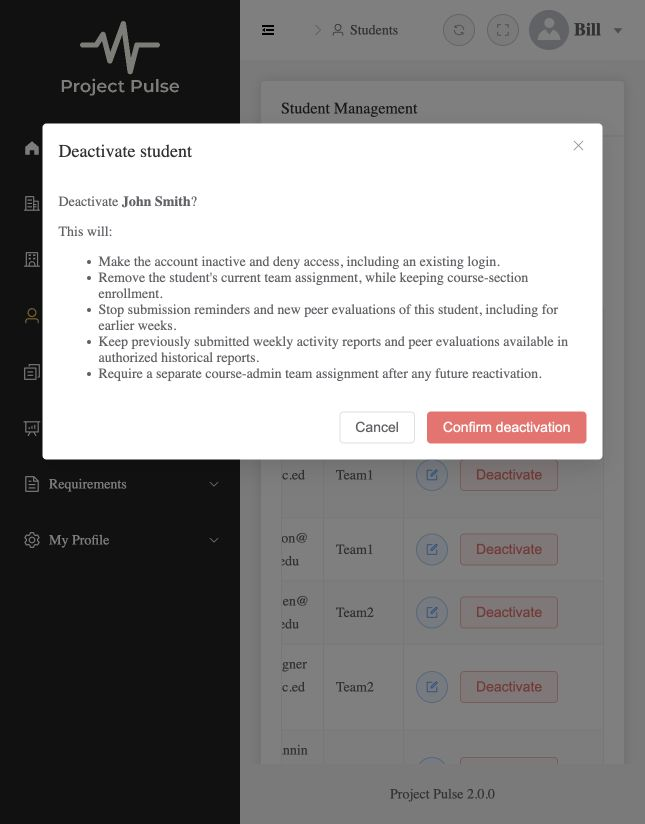

# Student deactivation build verification

Traces to UC-STU-deactivate-student, issue #1, merged design PR #2, and [the design of record](../design/stu.md). This report distinguishes passing feature tests from checks the environment could not complete.

## Commit boundaries

- `00a7e0b`: shared trunk (scoped locking queries, lifecycle transaction, permission predicate, account validator, historical selection, profile-status refusal). The developer reviewed it before leaf work resumed.
- `7c275dd`: security wiring (new POST route, live JWT account validation, scoped student/detail/section-report reads).
- `64f9005`: deactivation controller and HTTP/persistence tests.
- `1158c6b`: shared confirmation dialog, list/details status and actions, read-only profile status, component tests, Cypress specs, and screenshot.
- `d291bab`: the developer approved the period-summary read rule needed by the existing selected-student dashboard. It uses the same ownership predicate; tests retain self/privacy restrictions.

## Commands and outcomes

- Java 21, Maven, Docker MySQL 8 and Mailpit: trunk regression run **97 passed**, final trunk unit run **35 passed** (overlapping test runs; do not add their counts).
- Security wiring: `mvn test -Dtest=ActiveAccountSecurityIntegrationTest,ActiveAccountJwtValidatorTest,StudentLifecycleAuthorizationManagerTest`: **12 passed**.
- Endpoint: `mvn test -Dtest=StudentDeactivationApiIntegrationTest,StudentLifecycleIntegrationTest`: **22 passed**.
- Full backend `mvn test`: **481 passed, zero failures/errors/skips at `389a980`**, including the approved period-summary correction, before the audit-only test strengthening. An earlier full run also passed 481 tests; these are repeat runs, not 962 distinct tests.
- Approved period-summary correction: **18 passed** (`ActiveAccountSecurityIntegrationTest`, `StudentDeactivationApiIntegrationTest`).
- Frontend `npm run test:unit`: **14 passed**. Vitest/jsdom mounts real Element Plus dialogs, buttons, status tags, and student views; only API replies and unrelated dashboard report children are mocked.
- Frontend `npm run build-only`: **passed**. `npm run build` fails type checking with **18 errors identical to untouched fork main** (compared in a separate extracted baseline using the same dependencies). They are in existing navigation, report/chart, RAM editor, teams, and registration files; no feature file adds an error.
- Cypress `npx cypress run --spec cypress/e2e/deactivation.spec.cy.js`, both Electron and Chrome configurations: **could not start**; the native Cypress smoke test aborts with SIGABRT before any test executes. The Cypress spec is authored, not claimed as passing. A Docker fallback was abandoned after its image exhausted available disk; that image was removed and Docker/disk space recovered. No Cypress result is inferred from the component tests.
- `git diff --check`: passed at each commit boundary.
- Documentation checks: links/anchors in nine touched/core documents; 271 concrete requirement definitions, 98 UC/traceability rows, 20 active FR rows, six feature bindings, seven quality-scenario mappings, and 38 BR citations/backward UC-index sets passed. Four deferred FRs and the platform-level research objective are excluded as specified. The 25 existing empty extension fields belong to other use cases; no requirement text changed. Semantic review was scoped to this use case, its cited rules/FRs, and the approved design clarification; it is not a whole-spec quality review.

Parts 4–5 were subsequently audited and weak tests strengthened; see [the audit findings and mutation evidence](student-deactivation-parts-4-5.md). Production code is unchanged by that audit.

## Design oracle to actual test map

The test classes below are in `backend/src/test/java/team/projectpulse/` unless otherwise noted. `API` means `student/StudentDeactivationApiIntegrationTest`; `Persistence` means `student/StudentLifecycleIntegrationTest`; `Components` means `frontend/tests/deactivation.test.ts`. Backend service tests and real-token integration tests are separate from mocked frontend APIs.

| Oracle | Actual tests | Result / limit |
|---|---|---|
| T01 warning, confirmation, one POST | Components: `names the student and every consequence`; `sends one POST, disables Confirm while pending, and emits the committed DTO`; manual live dialog | Passed; Cypress spec also authored, unexecuted |
| T02 assigned student / retained enrollment and work | API: `deactivateAssignedStudentAndRepeat`; Persistence: `deactivateAssignedStudentPreservesEnrollmentAndRecords` | Passed |
| T03 no team | API/Persistence: `assignedInstructorCanDeactivateUnassignedStudent`; service: `deactivateUnassignedStudent` | Passed |
| T04 repeat / concurrency / stale confirmation | API: `deactivateAssignedStudentAndRepeat`; Persistence: `concurrentDeactivationSerializesOnStudent`; service: `alreadyInactiveStudentIsEntirelyUnchanged`; Components: `uses the exact unchanged outcome message and refreshes the DTO` | Passed in audit: first transaction held open while the second waits; the lock-removal mutation fails and the restored lock passes |
| T05 role and relationship matrix | API: `owningAdminWithoutInstructorAssignmentCanDeactivate`, `assignedInstructorCanDeactivateUnassignedStudent`, `unauthorizedCallersAndMalformedIdsLeaveStateUnchanged`; Persistence refusals; `StudentLifecycleAuthorizationManagerTest` | Passed, including student self/teammate, unrelated admin, unassigned instructor, anonymous, missing/malformed/overflow IDs |
| T06 no request on dismissal | Components: four `sends no POST on … dismissal` cases (Cancel, close icon, Escape, backdrop); manual Cancel | Passed in real Element Plus controls under jsdom; browser spec authored, unexecuted |
| T07 history and privacy | API: `historicalReportAfterDeactivation`, `studentPrivacyStillHolds`; approved summary-read regression; `EvaluationServiceTest.historicalReportIncludesInactiveUnassignedEvaluateesOnlyInRecordedWeeks` | Two recorded weeks, absent third week, complete detail DTOs (IDs/scores/comments/ratings), averages, scoped admin/instructor reads; privacy and approved period-summary correction checks passed |
| T08 existing login | API: `existingTokenDeniedAfterDeactivation`; security: `earlierTokenAndFreshLoginDeniedWhenStudentDisabled`; manual disabled student sign-in | Passed using real login-issued signed tokens, reads/writes 401, unchanged profile, active control and fresh-login refusal |
| T09 token and account failures | `ActiveAccountJwtValidatorTest`; `ActiveAccountSecurityIntegrationTest` malformed/missing IDs/accounts, disabled instructor, bad signature, expiry, database failure | Passed; decoder coverage uses signed tokens, not the `jwt()` authentication shortcut |
| T10 no new evaluation of inactive student | API: `cannotEvaluateInactiveStudentForPreviousOpenWeek`; service: `cannotEvaluateInactiveStudent`; Persistence: `previousOpenWeekDoesNotPermitEvaluatingInactiveStudent` | Passed for still-open previous week; no save; active evaluatee control succeeds |
| T11 obligations/reminders | API: `deactivationRemovesOwedItemsAndInactiveEvaluateeObligation`; `StudentDeactivationReminderIntegrationTest.inactiveStudentIsNotEmailedAfterDeactivationAndActiveControlIs`; existing submission-status and reminder tests | Passed: lifecycle removes owed items and teammate obligation; actual reminder send-time selection excludes the deactivated student and still emails an active control (SMTP only mocked) |
| T12 visible/read-only status | Components: all three `Student screens` tests (list, selected details, profile); manual list/status/action check | Passed; text plus success/danger tag, disabled inactive action, selected team removed, no status switch |
| T13 one lifecycle path | API: `profileUpdateCannotChangeStatus`; service: `profileCannotChangeStatusInEitherDirection`; ordinary-profile regression tests | Passed: both transitions refused before profile writes, same-status edit permitted |
| T14 WAR retention | API: `retainedActivitiesRemainVisibleThroughHistoricalQuery`; Persistence retained-record counts; existing activity integration | Passed; before/after historical activity DTOs preserve IDs, team references and values for authorized callers |
| T15 rollback | Persistence: `deactivationRollbackRestoresBothChanges` | Passed after audit rewrite: committed fixture, induced failure after flush, separate transaction reload, enabled state and team restored without automatic test rollback supplying the result |
| T16 failure/unknown state | Components: network and gateway-timeout variants of `keeps an unknown outcome disabled until status is refreshed`; `cannot bypass a failed refresh by closing and reopening; retry refresh can reveal inactive`; `does not show success or invent status after a 403` | Passed; browser redirect behavior is covered by authored Cypress assertions, which could not execute |

## Tests kept and their oracles

- `StudentLifecycleServiceTest.deactivateAssignedStudentAndRepeat`: T02/T04, 6a and 3a.
- `StudentLifecycleServiceTest.alreadyInactiveStudentIsEntirelyUnchanged`: T04, extension 3a forbids cleanup or profile writes on repeat.
- `StudentLifecycleServiceTest.deactivateUnassignedStudent`: T03, extension 6b.
- `StudentLifecycleServiceTest.unauthorizedRoleDoesNotLookUpOrChangeStudent`: T05, lifecycle role gate.
- `StudentLifecycleServiceTest.outOfScopeOrUnknownStudentDenied`: T05, relationship gate and fail-closed lookup.
- `StudentLifecycleServiceTest.profileCannotChangeStatusInEitherDirection`: T13, no alternate lifecycle path.
- `StudentLifecycleIntegrationTest.deactivateAssignedStudentPreservesEnrollmentAndRecords`: T02 and 6c.
- `StudentLifecycleIntegrationTest.assignedInstructorCanDeactivateUnassignedStudent`: T03/T05.
- `StudentLifecycleIntegrationTest.owningAdminNeedsNoSectionInstructorAssignment`: T05 course ownership.
- `StudentLifecycleIntegrationTest.unrelatedAdminAndStudentSelfDeniedWithoutChanges`: T05 denials.
- `StudentLifecycleIntegrationTest.unknownAccountDeniedAndMissingAccountDisabled`: T05/T09.
- `StudentLifecycleIntegrationTest.historicalEvaluateesSurviveOnlyInRecordedWeeks`: T07 selection and retention.
- `StudentLifecycleIntegrationTest.deactivationRollbackRestoresBothChanges`: T15 transaction oracle.
- `StudentLifecycleIntegrationTest.unassignedInstructorDenied`: T05 assignment required.
- `StudentLifecycleIntegrationTest.liveStatusLookupIncludesInstructorAccounts`: T09 / FR-SEC-active-account.
- `StudentLifecycleIntegrationTest.previousOpenWeekDoesNotPermitEvaluatingInactiveStudent`: T10.
- `StudentLifecycleIntegrationTest.concurrentDeactivationSerializesOnStudent`: T04 overlapping requests.
- `StudentDeactivationApiIntegrationTest.deactivateAssignedStudentAndRepeat`: T02/T04, exact messages and persistent state.
- `StudentDeactivationApiIntegrationTest.assignedInstructorCanDeactivateUnassignedStudent`: T03/T05.
- `StudentDeactivationApiIntegrationTest.owningAdminWithoutInstructorAssignmentCanDeactivate`: T05.
- `StudentDeactivationApiIntegrationTest.unauthorizedCallersAndMalformedIdsLeaveStateUnchanged`: T05.
- `StudentDeactivationApiIntegrationTest.historicalReportAfterDeactivation`: T07, retained detail DTOs/averages for two weeks and no empty third-week row.
- `StudentDeactivationApiIntegrationTest.studentPrivacyStillHolds`: T07, self summaries omit private comments and teammates cannot read results.
- `StudentDeactivationApiIntegrationTest.existingTokenDeniedAfterDeactivation`: T08, actual POST then same-token read/write refusal.
- `StudentDeactivationApiIntegrationTest.profileUpdateCannotChangeStatus`: T13, both transitions refused, ordinary edit succeeds.
- `StudentDeactivationApiIntegrationTest.cannotEvaluateInactiveStudentForPreviousOpenWeek`: T10, inactive refusal and active control.
- `StudentDeactivationApiIntegrationTest.retainedActivitiesRemainVisibleThroughHistoricalQuery`: T14, full historical activity DTOs unchanged.
- `StudentDeactivationApiIntegrationTest.deactivationRemovesOwedItemsAndInactiveEvaluateeObligation`: T11.
- `StudentDeactivationReminderIntegrationTest.inactiveStudentIsNotEmailedAfterDeactivationAndActiveControlIs`: T11 / BR-submission-owed, actual send-time recipient selection with an active control; SMTP only mocked.
- `ActiveAccountSecurityIntegrationTest.earlierTokenAndFreshLoginDeniedWhenStudentDisabled`: T08.
- `ActiveAccountSecurityIntegrationTest.disabledInstructorTokenDenied`: T09 / FR-SEC-active-account.
- `ActiveAccountSecurityIntegrationTest.missingMalformedMissingAccountAndExpiredClaimsDenied`: T09.
- `ActiveAccountSecurityIntegrationTest.invalidSignatureDenied`: T09.
- `ActiveAccountSecurityIntegrationTest.databaseFailureCannotReachProfileWrite`: T09, no controller side effect on lookup failure.
- `ActiveAccountSecurityIntegrationTest.owningAdminWithoutInstructorAssignmentCanReadStudentAndHistoricalReports`: T05/T07.
- `ActiveAccountSecurityIntegrationTest.lifecycleRouteDeniesSelfUnrelatedAndUnknownOrMalformedIds`: T05.
- `ActiveAccountJwtValidatorTest.observesCurrentStateOnEveryRequest`: T08/T09, no enabled-status cache.
- `ActiveAccountJwtValidatorTest.malformedOrMissingIdNeverLooksUpAnAccount`: T09.
- `ActiveAccountJwtValidatorTest.missingDisabledAccountAndDatabaseFailureDenyAccess`: T09.
- `StudentLifecycleAuthorizationManagerTest.missingMalformedAndOverflowIdDenyWithoutLookup`: T05.
- `StudentLifecycleAuthorizationManagerTest.validIdRequiresLifecycleRelationship`: T05.
- `EvaluationServiceTest.cannotEvaluateInactiveStudent`: T10 / BR-deactivated-student-evaluations.
- `EvaluationServiceTest.historicalReportIncludesInactiveUnassignedEvaluateesOnlyInRecordedWeeks`: T07 / BR-deactivated-student-evaluations.
- Components, `names the student and every consequence`: T01 warning.
- Components, `sends one POST, disables Confirm while pending, and emits the committed DTO`: T01 confirmation.
- Components, `sends no POST on cancel dismissal`: T06 / 4a.
- Components, `sends no POST on close dismissal`: T06 / 4a.
- Components, `sends no POST on escape dismissal`: T06 / 4a.
- Components, `sends no POST on backdrop dismissal`: T06 / 4a.
- Components, `uses the exact unchanged outcome message and refreshes the DTO`: T04 / 3a.
- Components, `keeps an unknown outcome disabled until status is refreshed` (network error): T16.
- Components, `keeps an unknown outcome disabled until status is refreshed` (gateway timeout): T16.
- Components, `cannot bypass a failed refresh by closing and reopening; retry refresh can reveal inactive`: T16.
- Components, `does not show success or invent status after a 403`: T16.
- Components, `puts labeled status beside the name and disables an inactive action in the list`: T12.
- Components, `refreshes selected details and team after the dedicated action`: T12.
- Components, `renders profile status as read-only`: T12.
- Cypress (unexecuted), `warns of every consequence and confirms once while pending`: T01.
- Cypress (unexecuted), `sends no request on cancel`: T06 / 4a.
- Cypress (unexecuted), `sends no request on close`: T06 / 4a.
- Cypress (unexecuted), `sends no request on escape`: T06 / 4a.
- Cypress (unexecuted), `sends no request on backdrop`: T06 / 4a.
- Cypress (unexecuted), `refreshes a stale confirmation with the exact already-deactivated message`: T04 / 3a.
- Cypress (unexecuted), `shows selected-details status beside the name and removes the team after success`: T12.
- Cypress (unexecuted), `keeps profile status read-only`: T12.
- Cypress (unexecuted), `refreshes status after a network failure before another action`: T16.
- Cypress (unexecuted), `treats a gateway timeout as unknown and reloads the committed status`: T16.
- Cypress (unexecuted), `keeps confirmation disabled if the status refresh also fails`: T16.
- Cypress (unexecuted), `uses the shared forbidden handling without claiming success`: T16.
- `StudentServiceTest.testStudentUpdateOwnInfo`: T13's same-status ordinary profile update.
- `StudentServiceTest.testInstructorUpdatesStudent`: T13's same-status ordinary profile update for an instructor.
- `StudentIntegrationTest.testStudentJohnUpdatesOwnInfo`: T13's real-API same-status ordinary profile update.
- Mocked frontend API replies establish component behavior only, not real authorization.
- Existing `StudentServiceTest` profile success payloads and `StudentIntegrationTest.testStudentJohnUpdatesOwnInfo` were rewritten to preserve status rather than silently attempt deactivation. The new T13 tests explicitly verify the rejected transition. No existing tests were deleted.

## The code deliberately broken

The historical-report selection test was initially the least trusted because a report based solely on current team membership could accidentally pass ordinary report tests. In `EvaluationService.generateWeeklyPeerEvaluationReportForSection`, its historical `forEach(student -> selected.putIfAbsent(student.getId(), student))` line was replaced temporarily by a no-op. `EvaluationServiceTest.historicalReportIncludesInactiveUnassignedEvaluateesOnlyInRecordedWeeks` went red: expected 5 rows, received 4. The original production line was restored and the final 35-test unit run passed. No mutation remains committed. The Parts 4–5 audit additionally found a WAR-retention test that stayed green under an empty-query mutation, rewrote it, and confirmed that the same mutation then failed; its controlled-overlap test also catches removal of the row lock. [Full audit evidence](student-deactivation-parts-4-5.md#mutation-evidence).

## Live UI evidence

Using the isolated local dev app, the instructor logged in, opened John's dialog, checked the warning, canceled (account and team unchanged), reopened and confirmed, then observed Inactive status, removed team, and a disabled Deactivate action. A subsequent John sign-in remained on login and was refused. This complements, rather than replaces, the signed-token API tests. The screenshot was captured before confirmation with real APIs.

## Review and limits

The implementation self-review checked the route and service scope predicates, current-account lookup and normal JWT validators, transaction/lock boundary, no schema change, historical-record selection/privacy, one lifecycle path, shared Axios API usage, and unknown-outcome retry handling. A discovered dashboard/period-summary authorization mismatch was raised to the developer and the scoped design correction was approved before implementation.

The developer reviewed the trunk. This report does not claim an independent fresh-context review or a human-authored labeled diff comment; those remain for the developer before requesting human review. The build PR must stay open and unmerged for grading. Full frontend type-checking and Cypress execution remain limitations, not passing results. General concurrent team reassignment and individual-token revocation remain outside this design.
